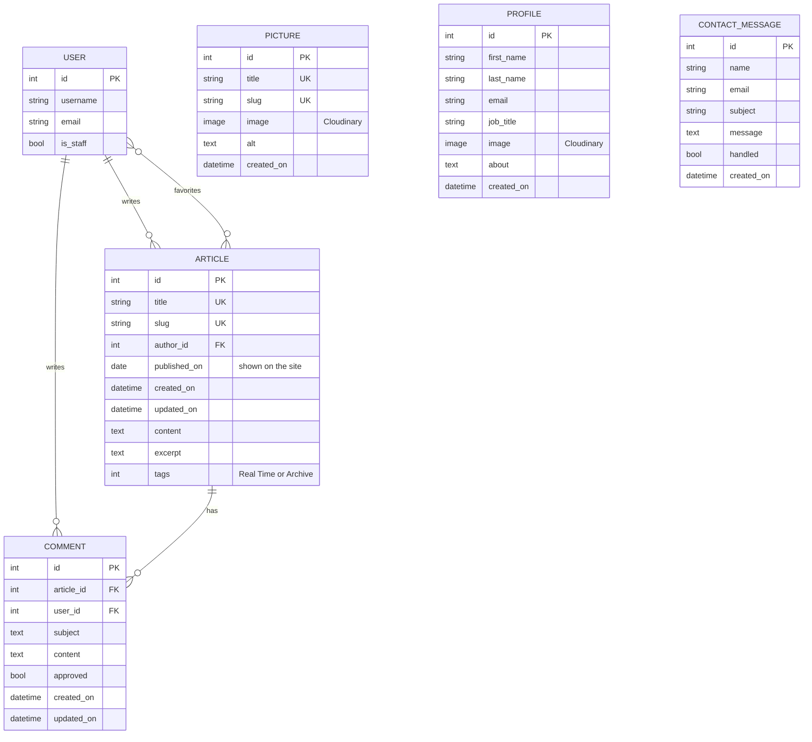

# Hermon Asmelash

## Release Eritrea

[](https://github.com/Hasmelash95/proclaim-release-eritrea/actions/workflows/deploy.yml)

[Check out the deployed site](https://www.release-eritrea.org/)

Proclaim! Release Eritrea is a human rights charity advocating for the persecuted Christians in Eritrea. It is a global partnership which advocates on behalf of victims of abuse by the PFDJ's (the ruling party of Eritrea) regime and provides humanitarian assistance to the victims and their families. The website offers updates to those who wish to learn more about the human rights abuses happening in Eritrea with press releases that logged in users can comment on and bookmark in their favorites. In addition, there are social media links, profiles of the members of Release Eritrea and a contact form for those visiting the site who wish to get in touch and get involved. 

The site was first built in 2023 and has since been maintained for the charity: upgraded to Django 5.2, given an automated test and deployment pipeline, made to work properly on phones and extended with a contact form. See [Maintenance and Updates](#maintenance-and-updates).


## Table of Contents

[User Experience](#user-experience)
* [Strategy](#strategy)
* [Scope](#scope)
* [Structure](#structure)
* [Surface](#surface)

[Features](#features)
* [Header and Hero](#header-and-hero)
* [About](#about-us)
* [Press Release](#press-releases)
* [Gallery](#gallery)
* [Footer](#footer)
* [Info](#info)
* [Contact Form](#contact-form)
* [Error Pages](#error-pages)
* [Future Features](#future-features)

[Maintenance and Updates](#maintenance-and-updates)

[Technologies Used](#technologies-used)

[Testing](#testing)
* [Validation](#validation)
* [Performance](#performance)
* [Automated Tests](#automated-tests)
* [Functional](#functional)
* [Browser Compatibility](#browser-compatibility)
* [Testing User Stories](#testing-user-stories)

[Bugs and Fixes](#bugs-and-fixes)

[Deployment](#deployment)

[Acknowledgements](#acknowledgements)

## User Experience (UX) <a name="user-experience">

### Strategy 
  
#### User Stories
  
The website is targeted toward any who are interested in aiding humanitarian efforts and wish to support Eritrean Christians who are being persecuted as well as any who know nothing about the charity and wish to learn more. It provides information via Press Releases and introduction texts for those unaware of the situation in Eritrea. 
  
Using Agile Methodology, User Stories were created from Themes and Epics with [GitHub Issues](https://github.com/Hasmelash95/release-eritrea/issues). Each User Story was marked with a label for prioritisation. Must do, Should do, Could do, Won't do. The latter are to be implemented in the next iteration (see future features). They were compiled as a result of lengthy discussion with the Director of Release Eritrea and potential users to establish what the target audience would be looking for in a site. 
  
Theme - Site Layout 
* Epic - Site Content
  
  1. Readability - As a Site User I can easily read the content on the site so that the process is stress free and not time consuming.
  
  2. Social Media - As a Site User I can find social media links on the site so that I can contact release through social media.
  
  3. Home Page - As a Site User I can peruse the home page so that I can see all the site has to offer.
  
* Epic - Site Navigation
  
  1. Navigation Bar - As a Site User I can click on the navigation links so that I can go to whichever section of the page I wish.
  
  2. Visible Navbar - As a Site User I can look at the navigation bar so that I can navigate to different parts of the site at any time.
  
  3. Home Page Links - As a Site User I can click on links on the home page so that I can navigate to different parts of the site.
  
Theme - Authentication System 
* Epic - Admin Authentication 
  
  1. Admin Signup - As a Site Admin I can Sign Up using a username and password so that I have access to the benefits an admin should have.
  
  2. Admin Login - As a Site Admin I can log in to my account so that I can make changes to the site whenever needed.
  
* Epic - User Authentication 
  
  1. User Signup - As a Site User I can Sign Up using a username and password so that I have access to the benefits a user should have.
  
  2. User Login - As a Site User I can Sign In so that I can comment on the posts.
  
Theme - View and Edit Content
* Press Releases 
  
  1. Post Articles From Site - As a Site Admin I can post articles from the site so that those visiting the site can read new updates from the organization.
  
  2. Edit Articles From Site - As a Site Admin I can edit and delete articles so that I can adjust the content or remove as necessary.
  
  3. Post Old Articles - As a Site Admin I can post old articles so that users can peruse stories from years before.
  
  4. Comment on Articles - As a Site User I can comment on articles so that I can share my thoughts.
  
  5. Favorites - As a Site User I can add articles to my favorites so that all my favorite articles can be found in one place.
  
  6. Article Filter - As a Site User I can search articles based on their title contents or tags so that I can find specific articles more swiftly.
  
 * Gallery and Info
  
   1. View Gallery - As a Site User I can find the gallery section so that I have a visual idea of what the org does.
  
   2. Edit Gallery - As a Site Admin I can edit, add and remove pictures so that the gallery section remains up to date.
  
   3. Add and Edit Info Contents - As a Site Admin I can add and remove content from the info page so that users can be updated on current team members and locations.
  
   4. View Info Page - As a Site User I can view the info page so that I can know who are the team members, how to contact them and where the offices are.

### Scope
  
The website will contain user authentication to allow those with staff permissions to log in and access the admin database and those with user permissions to comment and favorite posts. 
  
A single page will contain the About Us section (which will contain external links to partner charities and another page with information on the Team and a contact form). The main page will provide a list of Press Releases which can be navigated through using pagination. Clicking on any one of these will take the user to the article detail page where they can comment - which will be processed for admin approval - and favorite the article. The home page will also contain a gallery section which can be edited by admin. 
  
There will be links to allow users to access their favorites page and the search filter page to filter articles by tags and title content. 
  
Those with admin permissions will be able to add, edit and delete articles from the front end. 
  
Social media links will be available on the footer along with the charity and company number. 

### Structure

The logo at the header contains a link to the home page. Navigation links on the header allow users to navigate to the Home and the three sections on the home page, About Us, Press Releases, Gallery. Another link takes the user to the info page, and a Contact link jumps to the contact form on that page. User authentication links are also present on the header to take users to the log in, sign up or logout pages. 
  
The Press Releases section shows 6 article previews a page and clicking on any of the previews takes the user to that specific article. Attempting to access an article that has been deleted will raise a 404 error and the users will be taken to a custom 404 error page. 
  
#### Data Model



User is Django's built in user model. An article has one author and many comments, each comment belongs to one user, and users can add many articles to their favorites (a many-to-many relationship).

Picture (the gallery), Profile (members of Release Eritrea, not user profiles) and ContactMessage (messages from the contact form) have no relationships with other models. The Location model from the original release still exists to keep its data but is no longer shown on the site, so it is left out of the diagram.

### Surface 

Noto Serif Oriya and Roboto fonts were imported from google fonts for the headers and main text respectively. The main colour themes for the site use bootstrap backgrounds. text-bg-primary and text-bg-light classes ensure the foreground and background colours do not clash with bg-gradient also used for a gradient effect for the backgrounds. The main text within the site is rgb(0, 95, 161), a colour close to black. 

Other bootstrap classes are used to colour in the buttons, to ensure that they stood out in the page and are still visible against the background. Font awesome icons decorate some of the headings and the buttons to add a touch of decor to the site. 
  
A fade in effect is triggered when an object is visible to the user - some elements begin to appear as the user scrolls. 
  
## Features
  
### Header and Hero
  
The header contains the logo of Release Eritrea along with the name (a bird breaking a chain) along with the nav elements (in the toggler) which take the users to specific sections of the page or to other sites within the page. There are Sign In and Sign Up options for users who have not been authenticated with links to the relevant pages. 

If the User has already signed in, a 'Hello, [User Name]!' appears along with a Logout link. 

The header remains on screen as the user scrolls to allow for easy navigation. The active page is underlined (in this case, the home page). 
  
### About Us

The About Us section introduces visitors of the site to Release Eritrea and provides them information (simplified) to introduce them to the charity and what they do.

In addition, links are provided to give users additional resources, such as links to the Team Page and external links to partner charity websites (which open in another tab).

### Press Releases
  
The main draw of the site is of course the press releases. Previews with links to the detailed pages of the articles allow users to peruse through the many pages and click on whichever article captures their attention. 
  
Article detail pages have a comment section with a comment form, the latter of which is only visible to logged in users. Comments must be approved by the admin to be visible under the article.

Admin may click on the edit or delete buttons, or post a new article article from that section. There are also buttons to direct users to the Favorites or Search Filter pages.
  
The Search Filter page allows users to find the article they need through tags or words or phrases in the title.

### Gallery
  
The Gallery section shows users official Release Eritrea pictures for a visual sense of what the organisation does. Admin can add, edit and delete pictures via the admin page. 
  
### Footer
  
The Footer contains social media links (which open in a new tag) providing methods of contacting Release Eritrea. As well as the charity number and company number.
  
### Info
  
The Info page provides information on the profiles (not User profiles) of the Release Eritrea staff and team members with contact details in case users wish to get in touch with them directly. The office locations section was later replaced by a contact form, as the charity has no public office addresses. 
  
This data can be added, edited or deleted from the admin site.

### Contact Form

The team page ends with a "Get In Touch" form where anyone can send a message with their name, email, subject and message. Messages are saved to the database rather than emailed, and staff read them in the Django admin, where they can tick each one off as handled.

A hidden "honeypot" field protects the form from spam: it is invisible to people, but spam bots fill in every field, so messages with it filled in are quietly discarded.

### Django Admin
  
Django provides an authentication system that allows users to create accounts, login using their accounts and logout. Those with staff permissions can access the django admin site to make changes to the database. 

### Error Pages
  
Raising 400, 403, 404, 405 and 500 errors redirects the user to custom error pages with links to return to the home page.

### Future Features
  
1. Add a Donation feature via debit card and paypal. 
2. Send email notifications for new contact messages and enable password resets, once email sending is set up.

Contact Us, has since been added (see [Contact Form](#contact-form)).
  
## Maintenance and Updates

After the original release, the site was updated to keep it secure, supported and easier to maintain.

### Django 5.2 upgrade

* Upgraded from Django 4.2 to **Django 5.2** (the current long term support release) and from Python 3.9 to **Python 3.11**, along with django-allauth, django-filter, django-taggit, crispy forms and WhiteNoise.
* Replaced the `STATICFILES_STORAGE` and `DEFAULT_FILE_STORAGE` settings, which Django 5.1 removed, with `STORAGES`. Static files are now served by WhiteNoise with compressed, cache-busting file names, while uploaded images stay on Cloudinary.
* Removed unedited copies of django-allauth templates that no longer worked with allauth 65, keeping only the styled sign in, sign up and sign out pages.
* Pinned the Python version for Heroku with `.python-version`.

### Continuous integration and deployment

Every push to `main` runs a [GitHub Actions workflow](.github/workflows/deploy.yml):

1. **Check:** installs the requirements, runs Django's system check, checks for missing migrations, collects static files and runs the automated tests.
2. **Deploy:** only if every check passes, pushes the code to Heroku.

Database migrations run automatically on each deploy through a release phase in the `Procfile`. If a migration fails, the release is cancelled and the previous version stays live. The workflow can also be run by hand from the Actions tab to check any branch without deploying it.

### Mobile layout fixes

Pages were slightly wider than the screen on phones, which cut off the menu button and the edge of the text. Measuring every element at phone widths found three causes: Bootstrap `.row` elements used without a container (adding negative side margins), cards combining `width: 100%` with a margin, and a minimum width on the hero verse that was wider than a phone. All pages now fit the screen at common phone widths (360 to 414px).

## Technologies Used 
  
HTML5
  
CSS3
  
Python 3.11
  
JavaScript
  
Gitpod
  
Git
  
Heroku

[Django 5.2](https://www.djangoproject.com/)

[django-allauth](https://docs.allauth.org/)

PostgreSQL

[GitHub Actions](https://docs.github.com/en/actions)
  
[Bootstrap v5.3](https://getbootstrap.com/)

[Cloudinary](https://cloudinary.com/)

[django-filter](https://django-filter.readthedocs.io/en/stable/)
  
[django-crispy-forms](https://django-crispy-forms.readthedocs.io/en/latest/)
  
[django-summernote](https://github.com/summernote/django-summernote)
  
[Whitenoise](https://whitenoise.evans.io/en/latest/)
  
## Testing

### Validation

The validation and performance checks below were carried out for the original release in 2023.

* **JavaScript** was run through [JSHint](https://jshint.com/) with no errors.
* **Python** was run through the [PEP8 linter](https://pep8ci.herokuapp.com/) with no errors.
* **CSS** was run through the [W3C CSS Validator](https://jigsaw.w3.org/css-validator/validator) with no errors.
* **HTML** for every page was run through the [W3C Markup Validator](https://validator.w3.org/) with no errors in the custom code. The only errors are on the post and edit article pages, from attributes in a django-summernote widget that can't be changed from the project's templates.

### Performance

[Lighthouse](https://developer.chrome.com/docs/lighthouse) reports were run for every page of the site.

### Automated Tests

The site has a suite of Django tests that run on every push as part of the [CI/CD workflow](#continuous-integration-and-deployment), so nothing is deployed unless they pass. Each file covers one area:

| File | What it tests |
|---|---|
| [press/tests/test_views.py](press/tests/test_views.py) | Home, article detail, filter and favorites pages; posting, editing and deleting articles; comments; adding and removing favorites |
| [press/tests/test_permissions.py](press/tests/test_permissions.py) | Only staff can post, edit and delete articles; favorites need a signed in user |
| [info/tests/test_views.py](info/tests/test_views.py) | The team page |
| [info/tests/test_contact.py](info/tests/test_contact.py) | Sending a message, invalid messages, and spam being discarded |
| [tests/test_accounts.py](tests/test_accounts.py) | Sign in, sign up and sign out pages and flows |
| [tests/test_errors.py](tests/test_errors.py) | The custom 404 page |

Tests that belong to one app live in that app's `tests` folder, and site-wide tests live in the top-level `tests` folder.

To run them locally with a throwaway SQLite database:

```
DATABASE_URL=sqlite:///db.sqlite3 python manage.py collectstatic --noinput
DATABASE_URL=sqlite:///db.sqlite3 python manage.py test
```

### Functional
  
Functional tests were carried out to ensure the features of the site were working correctly. 
  
[Manual Functional Tests](README-assets/testing/functional-tests.pdf)

### Browser Compatibility 
  
Website was tested on Safari, Firefox, Google Chrome, Microsoft Edge, iOS and Android devices and was compatible with all of them. 
  
### Testing User Stories
  
User Stories were tested for whether they fulfilled the acceptance criteria defined within [Issues](https://github.com/Hasmelash95/release-eritrea/issues). They fulfilled the criteria. 
  
The only exception are those User Stories that were labelled "won't do" as they'll be added in the next iteration.
  
[User Stories Test](README-assets/testing/release-user-stories.pdf)

## Bugs and Fixes
  
  ### Fixed Bugs
  1. Edit article did not keep the input fields filled in, leading users to an empty form. This was fixed by adding the 'article': article to the context.
  2. Post article did not keep the input fields when the user's form was invalid triggering a refresh of the page. This was fixed by adding article_form = ArticleForm() at the top of the function. 
  3. The spinner showed up when the user clicked the sign in/sign up buttons even if the input was empty. If statements were added to ensure the spinner showed up when the required fields were filled in. 
  4. Summernote was creating validation errors due to attributes used in the widget. This was resolved by copying the iframe file (found in the summernote div github) into a template in my directory and manually removing the attributes. 
  
  5. Pages were wider than the screen on phones, cutting off the menu button. Fixed by removing the negative margins of Bootstrap rows used without a container and replacing a `width: 100%` plus margin combination with `width: auto` (see [Mobile layout fixes](#mobile-layout-fixes)).
  6. After upgrading to django-allauth 65, old copies of allauth templates in the project broke some account pages. Fixed by removing the unedited copies so allauth's own templates are used.
  7. On Django 5.1+, the Cloudinary package's `collectstatic` command failed because it reads the removed `STATICFILES_STORAGE` setting. Fixed by serving static files with WhiteNoise and keeping Cloudinary for uploaded images only.
  
  ### Unfixed Bugs
  1. There are no unfixed bugs remaining, besides the validation error triggered in the form pages due to the presence of an django widget that could not be adjusted.

## Deployment

### Deploying the App

The site is hosted on Heroku and deployed automatically by GitHub Actions.

1. Create a Heroku app and a PostgreSQL database (Heroku Postgres or another provider).
2. In the app's **Settings → Config Vars**, add:
   * `SECRET_KEY`: a long random string
   * `DATABASE_URL`: the PostgreSQL connection URL
   * `CLOUDINARY_URL`: from the Cloudinary dashboard, for uploaded images
3. Make sure **heroku/python** is the only buildpack and that `DISABLE_COLLECTSTATIC` is **not** set, as WhiteNoise needs static files collected on every deploy.
4. Turn off Heroku's own automatic deploys from GitHub (**Deploy** tab), so every deploy goes through the test workflow.
5. Create a Heroku API key (`heroku authorizations:create`) and add it to the GitHub repository under **Settings → Secrets and variables → Actions** as `HEROKU_API_KEY`.
6. Push to `main`. GitHub Actions runs the checks and tests, then deploys to Heroku. Heroku installs Python 3.11 (from `.python-version`), collects static files and runs the database migrations before the new version goes live.

### Running Locally

1. Create a virtual environment with Python 3.11 and install the requirements: `pip install -r requirements.txt`.
2. Create a `.env` file (it is ignored by git) with `SECRET_KEY`, `DATABASE_URL`, `CLOUDINARY_URL` and `DEBUG = "True"`.
3. Run `python manage.py migrate`, then `python manage.py runserver`.

### Cloning the Repository 
  
1. Log on to your Github account and head to the main page of the repository you wish to clone.
2. Click on the 'Code' button above the list of files and choose from HTTPS, SSH or Github CLI, to copy the URL provided.
3. Open terminal and ensure you are in the correct location.
4. Type in 'git clone' and paste the URL you'd copied in step 2 and press enter.
  
## Credits
  
The hero image was from [Unsplash by Eyasu Etsub](https://unsplash.com/photos/5wdR59K0nyI?utm_source=unsplash&utm_medium=referral&utm_content=creditShareLink)
  
[Font Awesome](https://fontawesome.com/icons) was used for the icons used throughout the site. 
  
Intersection Observer API from [MDN](https://developer.mozilla.org/en-US/docs/Web/API/Intersection_Observer_API) for fade on scroll effect.
  
[Favicon Generator](https://favicon.io/)
